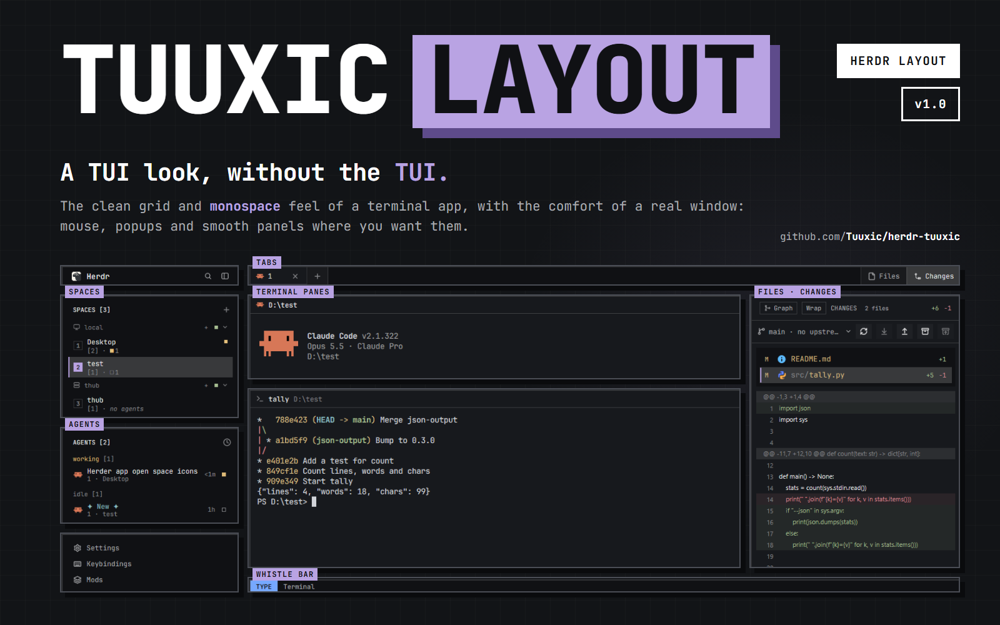

# Tuuxic

A complete [Herdr](https://herdr.dev) workspace: spaces and agents at a glance, file and git
panels beside your terminals, and 26 themes.

The sidebar lists your spaces, each with its open tabs and how many of its agents are
working, blocked, done or idle, and every agent with its title, tab and space. Next to
the framed terminals, a side panel switches between a file browser and git changes with a
graph. A command palette, a picker and a theme switcher round it off.

Tuuxic works with [whistle](https://github.com/Tuuxic/herdr-whistle), a vim-inspired keyboard
mode, installed alongside it and switched off: the bar under the terminals then only shows what
has the keyboard. To try it, open Settings → Keyboard and turn on Whistle mode.

## Install

Ask your coding agent to add tuuxic from [herdr.dev](https://herdr.dev). It follows
[RECIPE.md](RECIPE.md): it tells you what tuuxic uses, asks about the AI usage meters, offers
whistle, and switches to the layout if you want. The same file covers updating, removing
tuuxic, and installing single mods without the layout.

## Mods

Each mod's commands, props and settings: [docs/mods.md](docs/mods.md). Buttons that open
another tuuxic mod open Herdr's own screen when that mod is missing. The keyboard mode is
[whistle](https://github.com/Tuuxic/herdr-whistle), a separate install; tuuxic-bar draws its
bar and hints.

| Mod | What it is |
|---|---|
| [tuuxic-agents](docs/mods.md#tuuxic-agents) | Agents grouped by status or by priority; sub-agents fold under their parent |
| [tuuxic-ai-usage](docs/mods.md#tuuxic-ai-usage) | AI usage meters for the top bar |
| [tuuxic-bar](docs/mods.md#tuuxic-bar) | The top bar, and whistle's bar and hints |
| [tuuxic-changes](docs/mods.md#tuuxic-changes) | Git changes with diffs, commit and branch, and a git graph |
| [tuuxic-chrome](docs/mods.md#tuuxic-chrome) | The sidebar's header and its footer menu (Settings, Keybindings, Mods) |
| [tuuxic-files](docs/mods.md#tuuxic-files) | A file browser for the focused pane's folder, with read-only previews |
| [tuuxic-icons](docs/mods.md#tuuxic-icons) | The icons the other mods draw (assets only) |
| [tuuxic-keys](docs/mods.md#tuuxic-keys) | Every key binding, grouped by where it works |
| [tuuxic-layout](docs/mods.md#tuuxic-layout) | The release record: layout version, minimum Herdr, whistle range |
| [tuuxic-mod-manager](docs/mods.md#tuuxic-mod-manager) | Installed mods and the community index in one panel |
| [tuuxic-notes](docs/mods.md#tuuxic-notes) | Notes for the herdr-browser page being annotated |
| [tuuxic-pane](docs/mods.md#tuuxic-pane) | The header on each framed pane |
| [tuuxic-palette](docs/mods.md#tuuxic-palette) | The command palette |
| [tuuxic-picker](docs/mods.md#tuuxic-picker) | Go to a tab or space |
| [tuuxic-settings](docs/mods.md#tuuxic-settings) | Look, keyboard (whistle), machines, alerts and updates |
| [tuuxic-spaces](docs/mods.md#tuuxic-spaces) | Spaces with colored avatars, agent states and worktrees |
| [tuuxic-tabs](docs/mods.md#tuuxic-tabs) | The tab strip |
| [tuuxic-themes](docs/mods.md#tuuxic-themes) | A full-screen theme switcher |

## Before you install

- **tuuxic-ai-usage** reads your local login files for Claude Code, Codex (ChatGPT), GitHub
  Copilot, pi and opencode to show their usage limits, and calls those providers' usage
  endpoints with them, at most every 5 minutes per account:
  `api.anthropic.com/api/oauth/usage`, `chatgpt.com/backend-api/wham/usage` and
  `api.github.com/copilot_internal/user`. Nothing else is sent. Every file it reads:
  [docs/mods.md](docs/mods.md#tuuxic-ai-usage). Leave the mod out if you don't want that.
- tuuxic-mod-manager calls api.github.com; the browser pane and notes talk to herdr-browser
  on 127.0.0.1.
- Tuuxic runs git, sh or PowerShell, python3, hc, herdr-app and gh.
- It needs Herdr TODO(minimum Herdr: set from `"herdr"` in `mods/tuuxic-layout/mod.json` before v1.0.0) or newer.
- The terminal font is CaskaydiaMono Nerd Font; install it or change `font` in the layout.

## Docs

- [RECIPE.md](RECIPE.md): how the layout looks, behaves and is built; install, update and
  uninstall steps (written for agents).
- [docs/mods.md](docs/mods.md): every mod's props, commands, shared keys and settings.
- [CHANGELOG.md](CHANGELOG.md): what each release changed.
- [CONTRIBUTING.md](CONTRIBUTING.md): the repo, tests, versioning and releases.
- [GLOSSARY.md](GLOSSARY.md) and [docs/adr/](docs/adr): the words and the decisions.

## License

MIT ([LICENSE](LICENSE)). Code from elsewhere keeps its own notice, in the folder it ships in:

| File | Covers |
|---|---|
| `themes/LICENSE` | the themes |
| `mods/tuuxic-{agents,chrome,pane,spaces,tabs}/LICENSE-APACHE` and `NOTICE` | Herdr's Apache-2.0 code, from Herdr's built-in mods |
| `mods/tuuxic-{changes,files}/CHARMED-LICENSE.md` | Charmed icon and appearance code |
| `mods/tuuxic-changes/graph/LICENSE` and `NOTICE` | the git graph, MIT, forked from [herdr-git-graph](https://github.com/rabeeh-ta/herdr-git-graph) 0.3.0 |
| `mods/tuuxic-changes/graph/icons/LICENSE-lucide.txt` | Lucide icons |
| `mods/tuuxic-pane/browser/LICENSE` | the browser client, Apache-2.0 |
