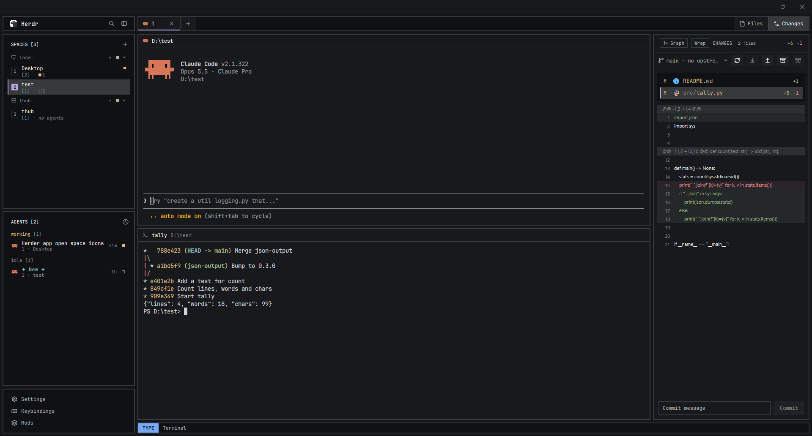

# Tuuxic

A dark, square-cornered workspace: a sidebar on the left with your spaces and agents, a tab
strip across the top, one framed terminal area, a side panel on the right that switches
between Files, Changes and browser notes, and a one-line status bar at the bottom that shows
the keyboard mode. Everything is drawn in the theme's colors, with no rounded corners.

## What you see

Top to bottom, left to right (sizes in logical px):

- **Top bar** (30, hidden by default; `super-shift-space` shows it): the logo button (opens
  the palette), a sidebar toggle, one number per space (the active one underlined in the
  accent, a space with an agent that needs you in the blocked color), a search button (the
  picker), then the active space's name, its folder if the terminal moved away, branch and
  `@machine`. AI usage meters sit in the middle; minimize, maximize and close on the right.
  The middle and right shares change below 1024 px of window width.
- **Sidebar** (243, a column):
  - **Header** (36): the Herdr logo and name, search, sidebar toggle.
  - **Spaces** (half of what's left): `SPACES [n]` and a + button, then spaces grouped by
    machine. Each space is two lines: a 16 px number badge centered on its left (accent
    filled when active, outlined otherwise), its name, branch on the right, a status square
    for working, blocked or done; below, dim: `[open tabs] · ` and its agents per state,
    most urgent first (◆ waiting, ■ working, ✓ done, □ idle, each in its state's color,
    states with none left out), or *no agents* in italics. Worktrees sit under their
    checkout on one line with a branch icon.
  - **Agents** (the other half): `AGENTS [n]` and a clock button for the sort; agents grouped
    by status (`working [1]`, `idle [2]`) or by priority. Each row: the program's icon, its
    title (or **✦ New ✦** in cyan when it has none), and below, dim, `tab · space`; on the
    right how long ago it changed and its status mark. Sub-agents fold under their parent.
  - **Footer** (106): Settings, Keybindings, Mods.
- **Tab strip** (36): tabs with their program icon, number and name, the active one with a
  2 px accent underline; a + button (new-menu); Files / Changes / Graph toggles on the right.
- **Terminal area**: the tab's panes, each framed (2 px border, the accent when focused) with
  a 30 px header (tuuxic-pane): icon, title, folder; zoom, split right, split down, close.
- **Side panel** (475, hidden until opened): a stack of Files (a tree of the focused pane's
  folder with read-only previews), Changes (changed files, diff, commit message, branch; a
  git graph view) and Browser notes.
- **Status bar** (22): whistle. Shipped off, it shows only what has the keyboard
  (`Terminal · <pane title>`); once turned on, a mode badge (TYPE or WHISTLE) on its left.

Fonts: CaskaydiaMono Nerd Font in terminals, JetBrains Mono for the interface. Theme:
tokyo-night by default; 26 themes ship in `themes/`.

## How it behaves

- **Agent statuses**: working is a 7 px square pulsing in the working color; blocked shows a
  "Needs you" badge (a "!" square on the narrow rail); done is a filled square; idle is an
  outlined square, its row's text muted. The spaces' second line counts the same four
  states. The agents list sorts by status groups, or by priority (most urgent first).
- **Sidebar**: drag its edge; below 160 px it snaps to a 44 px rail (76 on macOS) of number
  badges and icons. The toggle buttons switch between the rail and the last width.
- **Spaces**: click to select, drag to reorder, right-click for a menu. **Agents**: click to
  focus that terminal; pin one to the top with the pin on hover.
- **Tabs**: click, double-click to rename, drag to reorder, scroll to switch;
  `ctrl-alt-shift-t` reopens the last closed tab (its programs too, via python3).
- **Keys** (`keys.json`, section `layout:tuuxic`): `ctrl-shift-p` palette, `ctrl-shift-k`
  picker, `ctrl-,` settings, `ctrl-shift-m` mods, `super-k` keybindings, `super-ctrl-t`
  themes, `alt-1..9` tabs, `alt-left/right` and `ctrl-h/l` previous/next tab,
  `alt-up/down` spaces, `ctrl-arrows` panes, `alt-enter` / `alt-shift-enter` split,
  `super-w` close pane, `super-f` zoom, `super-shift-space` top bar, `ctrl-space` whistle.
- **Keyboard mode** (whistle, off until the Keyboard mode switch in Settings → Keyboard turns it
  on, through `whistle.on`; that writes `"enabled": true` to `~/.config/herdr-app/whistle.json`): `ctrl-space` enters WHISTLE; `ctrl-h/j/k/l` move
  between Spaces, Agents, the footer menu, Tabs, the terminal and the side panel (the field
  glows, its cursor item is outlined); `j/k` and Enter act inside; `i` back to typing. The
  layout's whistle block adds `s`/`a` (spaces, agents), `e`/`E` (files panel), `g`/`G`
  (changes panel), `/` (picker) and Space p/,/?/m (palette, settings, keys, mods).

## Built from

- **Layout tree** (`layouts/tuuxic.json`): root column → `topbar` row (hidden: `bar-left`
  tuuxic-bar `{part: "left"}`, `ai-usage` tuuxic-ai-usage `{compact: true}`, `bar-right`
  tuuxic-bar `{part: "right"}`) → `desk` row → `sidebar` column (`brand` tuuxic-chrome,
  `spaces` tuuxic-spaces, `agents` tuuxic-agents, `sidebar-footer` tuuxic-chrome
  `{footer: true}`) and `work` column (`tabs` tuuxic-tabs; `work-body` row with `main` (the
  tab's panes, header tuuxic-pane) and hidden `panel` column → `panel-body` stack of `files`
  tuuxic-files, `changes` stack (`changes-view` tuuxic-changes `{graph}`, `git-graph`
  tuuxic-changes `{view: "graph"}`), `browser-notes` tuuxic-notes) → `statusbar` whistle
  `{enabled: false, mappings}`.
- **Mods**: the 17 `mods/tuuxic-*` and `mods/whistle` (a copy of Tuuxic/herdr-whistle);
  tuuxic-icons holds the shared SVGs (assets only). tuuxic-settings shows its Whistle row
  only when `mods/whistle/main.js` exists.
  Dialogs: tuuxic-palette, tuuxic-picker, tuuxic-settings, tuuxic-keys, tuuxic-mod-manager,
  tuuxic-themes. Herdr's own mods used: new-menu, menu, prompt, picker (fallback).
- **Herdr API**: spaces(), agents(), panes(), terminals(), focused(), layout(), shared /
  setShared, keys(), commands(), openOverlay; commands like space.select, tab.select,
  agent.focus, pane.focus/go/split/zoom/close, layout.show/hide/select/resize, mod.open,
  app.palette/settings/help.
- **Keyboard navigation**: each taking-part mod carries `keynav.js` (protocol v1), announces
  itself in `shared("keynav.fields")` and draws its own highlight while
  `shared("keynav").active` names it.
- **Programs and network**: git (spaces, files, changes), sh or PowerShell (files listing),
  python3 (tabs' reopen), hc (spaces, settings, picker), herdr-app (bar's zoom), gh
  (mod-manager). tuuxic-ai-usage reads your local Claude, ChatGPT and Copilot login tokens
  and calls those providers' usage endpoints; tuuxic-mod-manager calls api.github.com; the
  panes' browser and notes talk to herdr-browser on 127.0.0.1. The git graph's own update
  check is off (`CHECK = false` in `graph/update.js`): it is a modified copy of
  herdr-git-graph v0.3.0, so upstream releases aren't its updates.
- **Art**: `mods/tuuxic-icons/*.svg`, `mods/tuuxic-bar/tuuxic.svg` (the logo), the files
  panel's file-type icons, `layouts/tuuxic.svg` (the layout's preview).

## Watch out

- Whistle ships switched off through the layout's `enabled: false` prop; the person's
  `whistle.json` wins over it. Without the `mods/whistle` folder the status bar shows
  "whistle did not load" and `herdr-app status` an error; the rest works. Update the copy
  from Tuuxic/herdr-whistle, not by hand.
- tuuxic-ai-usage reads credential files: tell the person before adding it.
- Windows has no `find`/`ls` on PATH: tuuxic-mod-manager and tuuxic-changes use Git for
  Windows' tools (found through `git --exec-path`), and Changes runs them through `sh -c`.
- The git graph view is MIT code from rabeeh-ta/herdr-git-graph (its LICENSE is in
  `mods/tuuxic-changes/graph/`).
- `ctrl-h` / `ctrl-l` switch tabs in this layout but move between fields while whistle has
  the keyboard (its own section wins).
- Copies of one file must stay the same: `keynav.js` in every taking-part mod and in whistle;
  `browser/client.js` in tuuxic-pane and `client.js` in tuuxic-notes; `opens.js` in
  tuuxic-bar, tuuxic-chrome and tuuxic-palette.

## Done when

- The window shows the sidebar (header, Spaces, Agents, footer), the tab strip, framed panes
  with headers and the 22 px status bar; `herdr-app status` lists no errors.
- A space with a working agent shows `[1] · ■1` under its name; a space without agents
  shows `[1] · no agents`.
- An agent without a title shows ✦ New ✦; its second line reads `1 · <space>`.
- `ctrl-shift-p` opens the palette, `ctrl-shift-k` the picker, `super-shift-space` shows the
  top bar with the logo on its left.
- The status bar shows `Terminal` with no badge; Settings → Keyboard → Whistle has a Keyboard
  mode switch, off; turning it on brings the TYPE badge, and Whistle settings' Open shows
  whistle's own dialog.
- With whistle on: `ctrl-space`, then `ctrl-h` makes the Spaces list glow, `j` moves its cursor,
  `e` opens the files panel with its first row outlined.
- With tuuxic-palette removed, the logo button opens Herdr's own palette instead.
