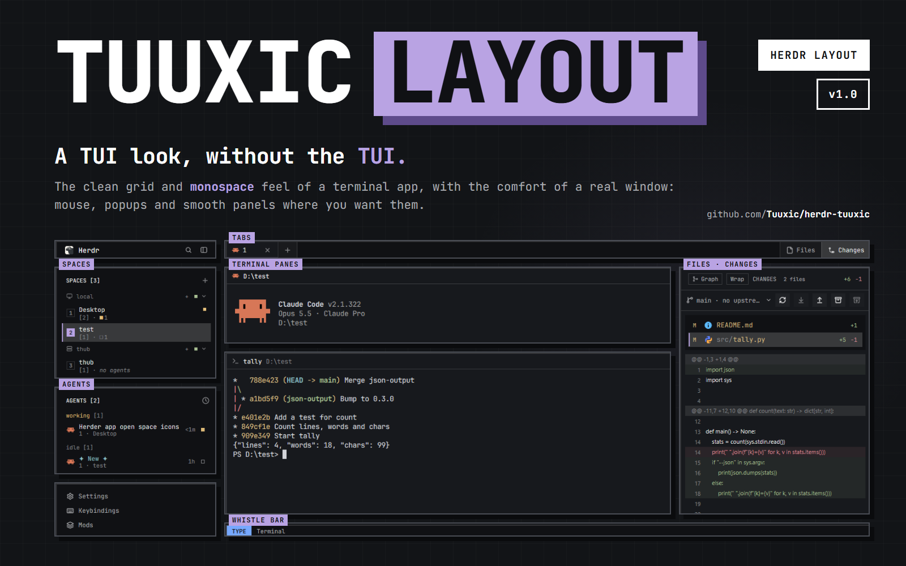

# Tuuxic

A dark, square-cornered workspace: a sidebar on the left with your spaces and agents, a tab
strip across the top, one framed terminal area, a side panel on the right that switches
between Files, Changes and browser notes, and whistle's one-line bar at the bottom that shows
the keyboard mode. Everything is drawn in the theme's colors, with no rounded corners.

> **Agents:** install, update and uninstall tuuxic only by the [Install](#install),
> [Single mods](#single-mods), [Update](#update) and [Uninstall](#uninstall) sections at the
> end, never by AGENTS.md's add steps: re-adding makes a renamed second copy. If tuuxic is
> already installed (`mods/tuuxic-layout/` exists), or a pre-1.0 tuuxic is (`layouts/tuuxic.json`
> exists and `mods/tuuxic-layout/` doesn't), go to [Update](#update). Talk to the person as
> [Talking to the person](#talking-to-the-person) says, in all four.



## Talking to the person

For Install, Single mods, Update and Uninstall alike. This recipe uses tuuxic's, whistle's and
Herdr's internal words ([GLOSSARY.md](GLOSSARY.md)); the person usually doesn't know them.

- **Plain words**: say "the keyboard mode" for whistle, "the sidebar lists" for spaces and
  agents, "the bar at the bottom" for whistle's bar. Name a file or command only when the
  person has to act on it.
- **Ask, with a default**: every question in this recipe has a default; say it ("I'll install
  the keyboard mode too, unless you'd rather not").
- **One summary at the end**, in the person's words: what they got, the two or three keys worth
  knowing, and what was left out or for later.

## What you see

Top to bottom, left to right (sizes in logical px):

- **Top bar** (30, hidden by default; `super-shift-space` shows it): the logo button (opens
  the palette), a sidebar toggle, one number per space (the active one underlined in the
  accent, a space with a blocked agent in the blocked color), a search button (the
  picker), then the active space's name, its folder if the terminal moved away, branch and
  `@machine`. AI usage meters sit in the middle; minimize, maximize and close on the right.
  The middle and right shares change below 1024 px of window width.
- **Sidebar** (243, a column):
  - **Header** (36): the Herdr logo and name, search, sidebar toggle.
  - **Spaces** (half of what's left): `SPACES [n]` and a + button, then spaces grouped by
    machine. Each space is two lines: a 16 px number badge centered on its left (accent
    filled when active, outlined otherwise), its name, branch on the right, a status square
    for working, blocked or done; below, dim: `[open tabs] · ` and its agents per state,
    most urgent first (◆ blocked, ■ working, ✓ done, □ idle, each in its state's color,
    states with none left out), or *no agents* in italics. Worktrees sit under their
    checkout on one line with a branch icon.
  - **Agents** (the other half): `AGENTS [n]` and a clock button for the sort; agents grouped
    by status (`working [1]`, `idle [2]`) or by priority. Each row: the program's icon, its
    title (or **✦ New ✦** in cyan when it has none), and below, dim, `tab · space`; on the
    right how long ago it changed and its status mark. Sub-agents fold under their parent.
  - **Footer** (106): Settings, Keybindings, Mods.
- **Tab strip** (36): tabs with their program icon, number and name, the active one with a
  2 px accent underline; a + button (new-menu); Files / Changes / Graph toggles on the right.
- **Terminal area**: the tab's panes, each framed (2 px border, the accent when focused) with
  a 30 px header (tuuxic-pane): icon, title, folder; zoom, split right, split down, close.
- **Side panel** (475, hidden until opened): a stack of Files (a tree of the focused pane's
  folder with read-only previews), Changes (changed files, diff, commit message, branch; a
  git graph view) and Browser notes.
- **Whistle's bar** (26 with its 2 px border, under the terminals), drawn by tuuxic-bar from
  whistle's public state: a mode badge (TYPE filled green, or WHISTLE) and what has the
  keyboard (`Terminal · <pane title>`, or the field). "Whistle off" while whistle is switched
  off. While a key sequence runs it shows the keys and the group's title; a hints box opens
  above it. Settings → Keyboard can move it to a full-width bar or hide it; with it hidden,
  the hints show in the bottom-right corner. Without whistle it shows one muted line (see
  [Watch out](#watch-out)).

Fonts: CaskaydiaMono Nerd Font in terminals, JetBrains Mono for the interface. Theme:
tokyo-night by default; 26 themes ship in `themes/`.

## How it behaves

- **Agent statuses**: working is a 7 px square pulsing in the working color; blocked shows a
  "Blocked" badge (a "!" square on the narrow rail); done is a filled square; idle is an
  outlined square, its row's text muted. The spaces' second line counts the same four
  states. The agents list sorts by status groups, or by priority (most urgent first).
- **Sidebar**: drag its edge; below 160 px it snaps to a 44 px rail (76 on macOS) of number
  badges and icons. The toggle buttons switch between the rail and the last width.
- **Spaces**: click to select, drag to reorder, right-click for a menu. **Agents**: click to
  focus that terminal; pin one to the top with the pin on hover.
- **Tabs**: click, double-click to rename, drag to reorder, scroll to switch;
  `ctrl-alt-shift-t` reopens the last closed tab (its programs too, via python3).
- **Keys** (`keys.json`, section `layout:tuuxic`, tuuxic's own keys only): `ctrl-shift-p`
  palette, `ctrl-shift-k` picker, `ctrl-,` settings, `ctrl-shift-m` mods, `super-k`
  keybindings, `super-ctrl-t` themes, `alt-1..9` tabs, `alt-left/right` and `ctrl-h/l`
  previous/next tab, `alt-up/down` spaces, `ctrl-arrows` panes, `alt-enter` /
  `alt-shift-enter` split, `super-w` close pane, `super-f` zoom, `super-shift-space` top bar.
- **Keyboard mode** (whistle, installed beside tuuxic, shipped off; Settings → Keyboard's
  Whistle mode switch runs `whistle.on` / `whistle.off`). Whistle's own keys: `ctrl-space`
  switches between TYPE and WHISTLE (`whistle.switch-mode`), `alt-s` / `alt-a` jump to the
  Spaces and Agents lists, `alt-,` opens whistle-ui's settings. In WHISTLE, `ctrl-h/j/k/l`
  move between Spaces, Agents, the footer menu, Tabs, the terminal and the side panel (the
  field glows, its cursor item is outlined); `j/k` move inside a field. In Spaces and Agents,
  Enter goes to the item and switches to TYPE, Space shows it and stays in WHISTLE. In Tabs,
  `x` closes the tab. The layout's mappings on `whistle-anchor` add `c` / `C` (Changes, show
  or hide Changes), `e` / `E` (Files, show or hide Files), `/` (picker) and `p` `,` `?` `m`
  (palette, settings, keys, mods).

## Built from

- **Layout tree** (`layouts/tuuxic.json`): root column → `topbar` row (hidden: `bar-left`
  tuuxic-bar `{part: "left"}`, `ai-usage` tuuxic-ai-usage `{compact: true}`, `bar-right`
  tuuxic-bar `{part: "right"}`) → `desk` row → `sidebar` column (`brand` tuuxic-chrome,
  `spaces` tuuxic-spaces, `agents` tuuxic-agents, `sidebar-footer` tuuxic-chrome
  `{footer: true}`) and `work` column (`tabs` tuuxic-tabs; `work-body` row with `main` (the
  tab's panes, header tuuxic-pane) and hidden `panel` column → `panel-body` stack of `files`
  tuuxic-files, `changes` stack (`changes-view` tuuxic-changes `{graph}`, `git-graph`
  tuuxic-changes `{view: "graph"}`), `browser-notes` tuuxic-notes). The whistle blocks:

  | Block | Mod | Props |
  |---|---|---|
  | `whistle-anchor` (0 px, work column) | whistle | `enabled: false`, `mappings` |
  | `tuuxic-whistle` (under the terminals) | tuuxic-bar | `whistle: "under"`, `hintsAlignRight: 6, hintsAlignBorder: 2, hintsGap: 11` |
  | `tuuxic-whistle-full` (full width, hidden) | tuuxic-bar | `whistle: "full"`, its own hints props |
  | `tuuxic-whistle-corner` (0 px) | tuuxic-bar | `corner: true` |
  | `whistle-corner` (0 px) | whistle-ui | `corner: true, hints: false` (draws nothing; lets `whistle-ui.settings` open) |

  `whistle-anchor` is the layout's only `"mod": "whistle"` block.
- **Mods**: the 18 `mods/tuuxic-*`; per-mod detail in [docs/mods.md](docs/mods.md).
  tuuxic-layout carries the release record in its `mod.json` (`version` the layout version,
  `herdr` the minimum Herdr, `whistle` the whistle range `>=2.0.0 <3.0.0`) and has no block.
  tuuxic-icons holds the shared SVGs (assets only). Whistle and whistle-ui are not in this
  repo: they come from [Tuuxic/herdr-whistle](https://github.com/Tuuxic/herdr-whistle).
  Dialogs: tuuxic-palette, tuuxic-picker, tuuxic-settings, tuuxic-keys, tuuxic-mod-manager,
  tuuxic-themes. Herdr's own mods used: new-menu, menu, prompt, picker (fallback).
- **Herdr API**: spaces(), agents(), panes(), terminals(), focused(), layout(), shared /
  setShared, keys(), commands(), openOverlay, readTextFile; commands like space.select,
  tab.select, agent.focus, pane.focus/go/split/zoom/close, layout.show/hide/select/resize,
  mod.open, app.palette/settings/help.
- **Keyboard navigation**: each of the six keynav mods (agents, changes, chrome, files,
  spaces, tabs) carries a copy of whistle v2.0.0's `keynav.js` (keynav v3), announces itself
  in `shared("keynav.fields")` and draws its own highlight while `shared("keynav").active`
  names it. tuuxic-settings and tuuxic-pane carry whistle's `whistle.js` to read whistle's
  state.
- **Programs and network**: git (spaces, files, changes), sh or PowerShell (files listing),
  python3 (tabs' reopen), hc (spaces, settings, picker), herdr-app (bar's zoom), gh
  (mod-manager). tuuxic-ai-usage reads local AI login files and calls those providers' usage
  endpoints (the full list: [docs/mods.md](docs/mods.md#tuuxic-ai-usage));
  tuuxic-mod-manager calls api.github.com; the panes' browser and notes talk to herdr-browser
  on 127.0.0.1.
- **Art**: `mods/tuuxic-icons/*.svg`, `mods/tuuxic-bar/tuuxic.svg` (the logo), the files
  panel's file-type icons, `layouts/tuuxic.svg` (the layout's preview).

## Watch out

- **Whistle is a separate install.** Without it the keyboard mode is gone and the rest works:
  `tuuxic-whistle` shows "Whistle isn't installed — hide whistle's bar in Settings → Keyboard";
  installed but not running, it shows whistle's problem or "Whistle isn't running". The
  whistle range is advisory: out of range, tuuxic keeps using whistle and says so only in
  Settings → Keyboard.
- **Tuuxic's layout is already integrated with whistle.** Never run whistle's Integrate on
  it: that would clone tuuxic-pane and edit `layouts/tuuxic.json`.
- tuuxic-ai-usage reads credential files: tell the person before adding it.
- Windows has no `find`/`ls` on PATH: tuuxic-mod-manager and tuuxic-changes use Git for
  Windows' tools (found through `git --exec-path`), and Changes runs them through `sh -c`.
- `ctrl-h` / `ctrl-l` switch tabs in this layout but move between fields while whistle has
  the keyboard (its own section wins).
- Some files are plain copies, kept by hand: `keynav.js` in the six keynav mods;
  `browser/client.js` in tuuxic-pane and `client.js` in tuuxic-notes; `opens.js` in
  tuuxic-bar, tuuxic-chrome and tuuxic-palette.

## Done when

- The window shows the sidebar (header, Spaces, Agents, footer), the tab strip, framed panes
  with headers and whistle's bar under the terminals; `herdr-app status` lists no errors.
- A space with a working agent shows `[1] · ■1` under its name; a space without agents
  shows `[1] · no agents`.
- An agent without a title shows ✦ New ✦; its second line reads `1 · <space>`.
- `ctrl-shift-p` opens the palette, `ctrl-shift-k` the picker, `super-shift-space` shows the
  top bar with the logo on its left.
- Whistle's bar shows "Whistle off"; Settings → Keyboard has a Whistle mode switch, off;
  turning it on brings the TYPE badge, and Open shows whistle-ui's settings.
- With whistle on: `ctrl-space`, then `ctrl-h` makes the Spaces list glow, `j` moves its
  cursor, `e` opens the files panel with its first row outlined.
- With tuuxic-palette removed, the logo button opens Herdr's own palette instead.

## Install

Paths are relative to the person's Herdr home (`~/.config/herdr-app/`).

1. **Tell the person first**, in plain words, what tuuxic uses:
   - programs: git, sh or PowerShell, python3, hc, herdr-app, gh;
   - network: api.github.com (mod manager), herdr-browser on 127.0.0.1 (browser pane, notes).

   Then ask about **tuuxic-ai-usage** on its own, default yes: it reads the person's local AI
   login files and calls those providers' usage endpoints (list them from
   [docs/mods.md](docs/mods.md#tuuxic-ai-usage)). On no, skip `mods/tuuxic-ai-usage/` and drop
   the `ai-usage` block from `layouts/tuuxic.json`.
2. Compare `herdr-app --version` with `"herdr"` in `mods/tuuxic-layout/mod.json`. If Herdr is
   older, say what may break and go on only on an explicit yes.
3. Copy `layouts/tuuxic.json` (and `layouts/tuuxic.svg`), every `mods/tuuxic-*` folder and
   `themes/`.
4. In keys.json, add the repo's `layout:tuuxic` section. Ask before replacing a key the person
   already uses.
5. **Whistle**, offered and installed by default: take the newest `v*` tag of
   [Tuuxic/herdr-whistle](https://github.com/Tuuxic/herdr-whistle) inside `"whistle"` in
   `mods/tuuxic-layout/mod.json`, and run that tag's RECIPE Install steps 1–6 (if whistle is
   already there, its Update instead). **Skip its steps 7 and 8**: tuuxic's layout already has
   the blocks and is already integrated.
   - Declined: remove the `whistle-anchor` and `whistle-corner` blocks, and hide
     `tuuxic-whistle` and `tuuxic-whistle-full`.
6. `herdr-app check mods/<name>` for each mod copied; each passes.
7. Ask whether to switch to the layout now, default yes. Yes: `herdr-app do layout.switch
   tuuxic`, then `herdr-app status` and `herdr-app shot`, checked against
   [Done when](#done-when). No: say they can pick Tuuxic in Herdr's layouts any time.
8. **Close with a summary** in the person's words: what's installed, `ctrl-shift-p` for the
   palette, `ctrl-space` for the keyboard mode once it's on in Settings → Keyboard, and
   anything left out.

## Single mods

For a person who wants some tuuxic mods without the layout. Only these are offered:
tuuxic-agents, tuuxic-ai-usage, tuuxic-changes, tuuxic-files, tuuxic-keys,
tuuxic-mod-manager, tuuxic-notes, tuuxic-palette, tuuxic-pane, tuuxic-picker,
tuuxic-settings, tuuxic-spaces, tuuxic-tabs, tuuxic-themes. tuuxic-layout, tuuxic-bar,
tuuxic-chrome and tuuxic-icons are never offered alone.

1. Copy each chosen `mods/tuuxic-<name>/`. With agents, spaces or tabs, also copy
   `mods/tuuxic-icons/` without asking, and say so in one line.
2. **Outside needs** are named, not installed: herdr-browser for notes and pane. For
   ai-usage, give the same disclosure as [Install](#install) step 1.
3. **Block mods** (agents, ai-usage, notes, pane, spaces, tabs): offer to add the mod's block
   to the shown layout, replacing Herdr's equivalent block where there is one (remember which,
   for Uninstall). Snippets:

   ```json
   { "id": "spaces", "type": "block", "size": { "weight": 1 }, "min": 90, "content": { "mod": "tuuxic-spaces" } }
   { "id": "agents", "type": "block", "size": { "weight": 1 }, "min": 90, "content": { "mod": "tuuxic-agents" } }
   { "id": "tabs", "type": "block", "size": { "px": 36 }, "content": { "mod": "tuuxic-tabs" } }
   { "id": "ai-usage", "type": "block", "size": { "px": 30 }, "content": { "mod": "tuuxic-ai-usage", "props": { "compact": true } } }
   { "id": "browser-notes", "type": "block", "content": { "mod": "tuuxic-notes" } }
   ```

   tuuxic-pane is a pane header, set inside the terminal block's `pane`:
   `"header": { "content": { "mod": "tuuxic-pane" }, "reveal": "always", "height": 30, "position": "top" }`.
4. **Keys**: offer the mod's keys from the repo's `layout:tuuxic` section as `global` lines
   (for example `"ctrl-shift-p": "mod.open:tuuxic-palette"`); ask before replacing a key the
   person uses.
5. `herdr-app check` each copied mod, then summarise as Install step 8 does.

### Single mods: Update

1. Replace each present `tuuxic-*` mod (tuuxic-icons included) in place from the newest
   release tag, deleting files the release doesn't ship.
2. Follow the [CHANGELOG](CHANGELOG.md) Upgrading notes newer than each mod's old version.
3. Add no mods and no blocks.

### Single mods: Uninstall

1. Remove the chosen mods and the blocks Single mods added; put back the Herdr block each one
   replaced.
2. Remove the `global` keys Single mods added.
3. Delete tuuxic-icons once no remaining mod reads it.
4. Ask before deleting the mods' saved settings.

## Update

For the layout, single mods and a pre-1.0 tuuxic.

1. **Old versions**: read the top-level `"version"` from `mods/tuuxic-layout/mod.json` and each
   `mods/tuuxic-*/mod.json`. `cloned_from.version` is nested and isn't the mod version. A
   `tuuxic-*` mod.json without a top-level `version` is pre-1.0; so is `layouts/tuuxic.json`
   without `mods/tuuxic-layout/`.
2. **Source and notes**: the newest `v*` release tag of this repo. Give the same Herdr warning
   as [Install](#install) step 2. Read the [CHANGELOG.md](CHANGELOG.md) entries newer than the
   old version (pre-1.0: from v1.0.0 on) now: steps 3–7 follow them, and an Upgrading note
   replaces or extends the matching step below.
3. **Mods**: unless an Upgrading note says otherwise, replace the present `tuuxic-*` folders in
   place, deleting files the release doesn't ship. Absent mods stay absent. Offer a mod that is
   new in the release; never add it silently. `tuuxic-layout` is not offered: always add or
   replace it, it is the layout's version record.
4. **Layout**: unless an Upgrading note says otherwise, replace `layouts/tuuxic.json` and
   `layouts/tuuxic.svg` when the release changed them, and the themes tuuxic ships (leave
   others).
   - Compare the person's `layouts/tuuxic.json` with the old release's file: `v<old version>`
     of this repo, or for pre-1.0 the file at commit `37a7681` (the last pre-1.0 change). If it
     differs and matches no earlier version in the repo's history, they edited it: show the
     diff, say so and ask first.
   - Delete `layouts/.state/tuuxic.json`, and say that sizes and shown or hidden panels reset.
   - Re-apply the removals for absent mods (the `ai-usage` block). Whistle's removals come at
     step 6.
5. **keys.json**: change it only where an Upgrading note says to. Remove a section left empty.
6. **Whistle**, once, after the Upgrading notes' other steps (a whistle note is done here):
   - missing: offer to install it ([Install](#install) step 5);
   - a newer `v*` tag inside the range: offer whistle's Update;
   - the release raised the range past the installed whistle: say so before offering its
     Update;
   - declined, now or earlier: remove its layout blocks as [Install](#install) step 5 does and
     its `whistle.*` keys.json bindings, removing a section left empty.
   - `whistle-integration.md` is whistle's file in the Herdr home (its Integrate writes it);
     skip a note about it if absent.
7. **CHANGELOG**: relay the entries from step 2, breaking changes first.
8. `herdr-app check` each mod, `herdr-app status`, and a shot against [Done when](#done-when)
   if tuuxic is shown. Summarise in the person's words.

A pre-1.0 tuuxic is taken to 1.0 by this section: the v1.0.0 entry's Upgrading notes in
[CHANGELOG.md](CHANGELOG.md) carry the extra steps.

## Uninstall

1. If tuuxic is the shown layout, ask which layout to switch to (`main` first) and switch.
2. Delete `layouts/tuuxic.json`, `layouts/tuuxic.svg`, `layouts/.state/tuuxic.json` and
   `mods/tuuxic-layout/`.
3. Delete each `tuuxic-*` mod that no other layout uses. Ask about the ones another layout
   uses.
4. In keys.json, remove the `layout:tuuxic` section and the `global` lines Single mods added.
5. Ask before deleting tuuxic's themes, by name; switch away from the one in use first.
6. Ask before deleting tuuxic's saved settings, `<appHome>/tuuxic.json` (the hints box
   switch) among them.
7. Ask about whistle, default keep. On yes, run whistle's Uninstall: it removes
   `whistle-anchor` and `whistle-corner` and leaves the tuuxic-whistle blocks, which go with
   the layout anyway.
